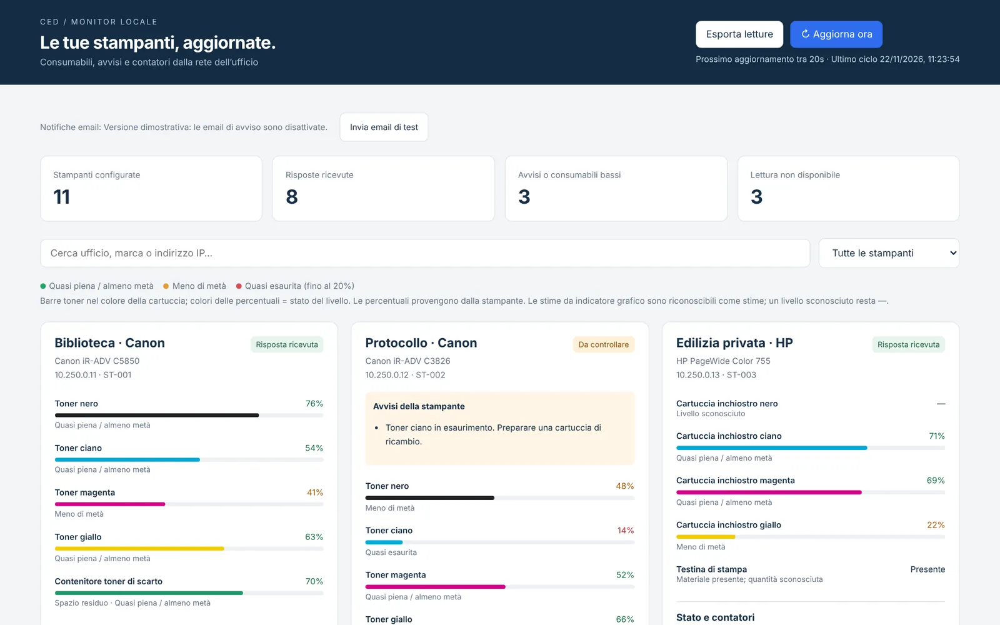
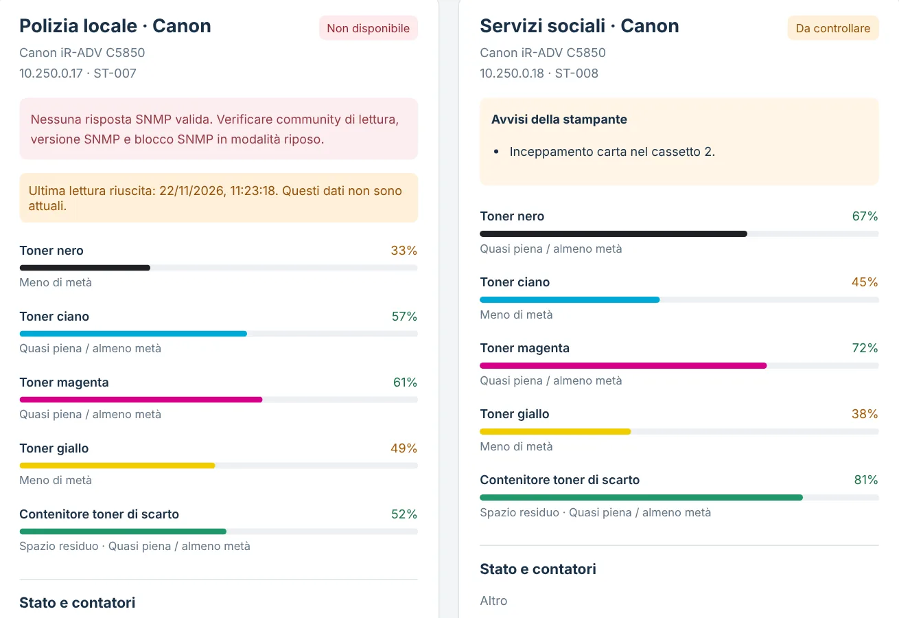
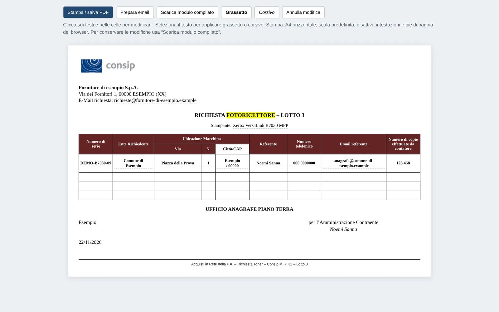

# Dashboard stampanti

Legge dalle stampanti di rete toner, tamburi, carta, contatori e avvisi, e li mostra in una pagina sola.

> **Versione pubblica ripulita.** Codice, dati di prova, schermate e descrizioni sono stati controllati e ripuliti da dati sensibili: nomi, indirizzi, account, matricole, recapiti e credenziali sono inventati, e non ci sono riferimenti interni reali. Lo stemma dell'ente non è incluso.

| | |
|---|---|
| Categoria | Inventario IT |
| Contesto | Stage del 4° anno al Comune di Verolanuova |
| Stato | Realizzato durante lo stage |
| Tecnologie | Python, HTML, JavaScript, SNMP, PowerShell |
| Demo | Inclusa, con dati inventati |

## Dal caos all'ordine

**Prima:** Toner che finiscono all'improvviso e un giro fra gli uffici per leggere i display.

**Dopo:** Livelli, avvisi e contatori di tutte le stampanti, aggiornati da soli.

## Contesto

Un ente ha stampanti di marche e modelli diversi negli uffici. Sapere quando ordinare un toner o un tamburo voleva dire controllarle una a una.

## Il problema

Le informazioni c'erano, ma sparse: ogni stampante le mostra sul proprio display o nella propria pagina web, ciascuna a modo suo.

## La soluzione

Un servizio Python che interroga le stampanti in sola lettura con il protocollo SNMP e una pagina che mostra lo stato di ognuna, con colori, avvisi, vassoi e contatori. Quando un consumabile scende sotto il 20% manda un avviso con Outlook, e prepara il modulo di richiesta del fotoricettore.

## Come funziona

1. Stampanti in rete
2. Lettura SNMP
3. Livelli e avvisi
4. Dashboard
5. Avviso email
6. Modulo di richiesta

## Funzioni principali

- Modello, matricola, contatori, toner, tamburi, avvisi, vassoi e messaggi del display
- Rosso fino al 20%, arancione sotto il 50%, verde dal 50% in su
- Valori sconosciuti mostrati come —, mai come 0%
- Ripiego automatico sul protocollo più vecchio, SNMPv1
- Ultima lettura valida conservata quando una stampante non risponde
- Aggiornamento periodico o immediato ed esportazione delle letture
- Avvisi email tramite Outlook classico, uno per episodio
- Modulo di richiesta del fotoricettore precompilato (non invia ordini)
- Avvio automatico all'accesso a Windows

## Casi inclusi nella demo

- Dieci stampanti simulate sul tuo PC, più una senza indirizzo
- Toner quasi finito, inchiostro con livello sconosciuto, carta inceppata
- Una stampante spenta, una che smette di rispondere, una che parla solo SNMPv1
- Un toner che scende sotto il 20% mentre guardi

## Privacy

- Solo letture: il programma non modifica le stampanti.
- La pagina risponde solo sul computer che la esegue.
- Nella demo indirizzi, matricole e recapiti sono inventati e nessuna email parte.

## Limiti

- Non tutti i modelli espongono ogni dato: ciò che manca resta vuoto.
- Gli avvisi richiedono Outlook classico aperto nella stessa sessione di Windows.
- Ogni stampante reale va verificata al primo avvio.

## Schermate

Schermate della versione dimostrativa, con dati inventati.



_Riepilogo e schede delle stampanti simulate._



_Una stampante che tace mostra l'ultima lettura riuscita, segnalata come non attuale. Accanto, una carta inceppata._



_Modulo di richiesta del fotoricettore, con fornitore e recapiti inventati._

## Provarlo

```bash
python3 demo_simulatore.py
```

Su Windows avvia `DEMO_SIMULATORE.cmd`. Si apre http://127.0.0.1:8767 con dieci stampanti simulate: nessuna lettura in rete, nessuna email. Test: `python3 -m unittest test_dashboard`.

La demo pronta da scaricare, in un unico ZIP, è nella cartella [`demo/`](demo/).

**Verificato:** Test automatici del programma e demo con le stampanti simulate in Chrome su Linux con Python 3.12: tutti i casi descritti, compreso il modulo di richiesta.

**Non verificato:** Avvii .cmd, avvio automatico e Outlook non provati su Windows. Un test automatico di arresto a volte fallisce anche nella versione originale, per una questione di tempi.

---

Parte del [portfolio dei progetti di stage](https://github.com/Shad272/portfolio) di Angelo Erik Scontrino.
